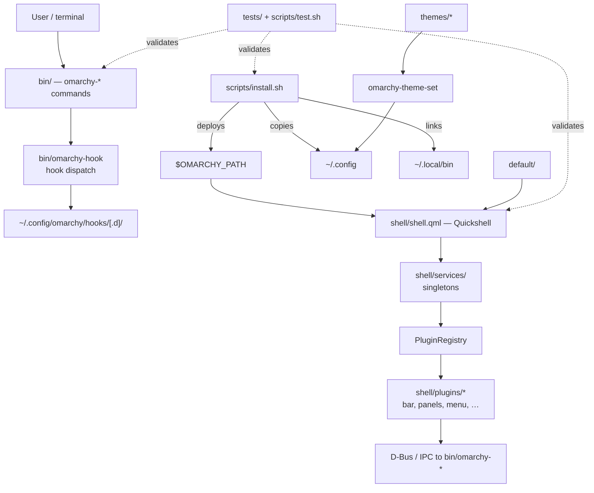

# Architecture

How Fedarchy is put together, based on the current filesystem.

> For the internal logic of each subsystem, see [BACKEND.md](BACKEND.md).

---

## 1. Directory map

```
Fedarchy/
├── bin/          453 omarchy-* commands (the CLI surface)
├── shell/        The Quickshell desktop shell (QML + JS)
│   ├── shell.qml        Shell entry point
│   ├── Commons/         Shared QML helpers
│   ├── Ui/              Reusable UI components
│   ├── services/        Long-lived singletons (plugin registry, app library, …)
│   └── plugins/         bar, panels, menu, background, lock, osd, …
├── default/      Runtime resources (hypr, bash, systemd, wayland-sessions, …)
├── config/       User-configuration templates (hypr, terminals, browsers, …)
├── themes/       22 theme definitions (colours, backgrounds, per-app maps)
├── scripts/      Setup installer, test runner, dev-run, relocation test
├── tests/        35 test files
├── docs/         This documentation suite
├── assets/       (empty placeholder)
└── Wallpapers/   (empty placeholder)
```

### `default/` vs `config/` — an important distinction

These two directories look similar and are **not** interchangeable:

| Directory | Role | Evidence |
|---|---|---|
| `default/` | **Runtime resources** deployed into `$OMARCHY_PATH`: Hyprland Lua (`bootstrap.lua`, `autostart.lua`, `helpers.lua`), the Wayland session file (`default/wayland-sessions/omarchy.desktop`), bash helpers, systemd units, environment defaults | Listed in the installer's `RUNTIME_CONTRACT`; deployed via `DEPLOYED_DIRS` |
| `config/` | **User-configuration templates** copied into `~/.config`: Hyprland config, terminal configs (alacritty, foot, ghostty, kitty, …), browser configs, `config/omarchy/shell.json` | Installer copies these to `${CONFIG_HOME}`; `config/omarchy/shell.json` is in `RUNTIME_CONTRACT` |

Files sharing a basename across the two trees are **not** duplicates. For example
`default/hypr/bindings/*.lua` (shipped defaults) and the live
`~/.config/hypr/modules/binds.lua` are different files serving different roles —
see [hyprland-keybindings.md](hyprland-keybindings.md).

---

## 2. How the pieces relate



---

## 3. Subsystems

### CLI layer — `bin/`
453 executables, each a focused task. They are **thin wrappers**: most call a
shared helper, a system tool (`nmcli`, `wpctl`, `brightnessctl`, `dnf5`), or
another `omarchy-*` command. They are not a monolithic dispatcher — each file is
a standalone script.

Families by size: `theme` (43), `install` (40), `remove` (30), `hw` (28),
`launch` (25), `hyprland` (25), `update` (17), `restart` (16), `menu` (14).

### Hook dispatch — `bin/omarchy-hook`
The one genuine dispatcher. `omarchy-hook <name> [args...]` runs
`~/.config/omarchy/hooks/<name>` and everything executable in
`~/.config/omarchy/hooks/<name>.d/`. Hook names are validated: empty names, names
containing `/`, `.`, and `..` are rejected so a name cannot escape the hooks
directory. Documentation files (`README*`, `LICENSE`, `*.md`, `*.txt`, `*.rst`)
in a `.d/` directory are skipped.

### Shell — `shell/`
One long-running Quickshell process per graphical session (105 QML, 28 JS
files). `shell.qml` boots the services and plugin registry; plugins render the
bar, panels, and overlays. Shared singletons (`PluginRegistry`, `AppLibrary`,
`BarWidgetRegistry`, …) live in `shell/services/` so they exist once per session
rather than once per plugin.

### Installer — `scripts/`
`install.sh` (deployment, profiles, preflight, backups, rollback) and
`install-components.sh` (the component manifest: `COMPONENT_SPECS`, dependency
resolution, `profile_components`).

### Themes — `themes/`
22 themes, each a directory of colour definitions, backgrounds, and per-app
colour maps. `omarchy-theme-set` applies one to the user config.

### Tests — `tests/` + `scripts/test.sh`
`scripts/test.sh` is the entry point that runs the registered suites and prints
a single pass/fail count. Standalone suites (`installer-test.sh`,
`installer-ux-test.sh`, `hooks-backend-test.sh`) run separately. → [TESTING.md](TESTING.md)

---

## 4. Runtime paths

| Path | Purpose |
|---|---|
| `$OMARCHY_PATH` | Deployed Fedarchy tree (default `~/.local/share/fedarchy`) |
| `~/.local/bin` | Installed `omarchy-*` commands |
| `~/.config/omarchy/` | Shell config, `shell.json`, `themes/`, `hooks/`, `plugins/` |
| `~/.config/hypr/` | **Live** Hyprland config that is actually loaded |
| `~/.local/state/fedarchy/` | Installer state |
| `~/.config/fedarchy-backups/` | Installer backups (override with `FEDARCHY_BACKUP_DIR`) |
| `~/.config/fedarchy/environment` | Generated environment file |

`OMARCHY_PATH` is resolved in `bin/omarchy-launch-shell` as
`${OMARCHY_PATH:-$HOME/Fedarchy}`.

---

**See also:** [BACKEND.md](BACKEND.md) · [CONFIGURATION.md](CONFIGURATION.md) ·
[COMMAND_REFERENCE.md](COMMAND_REFERENCE.md) · [DEVELOPMENT.md](DEVELOPMENT.md)